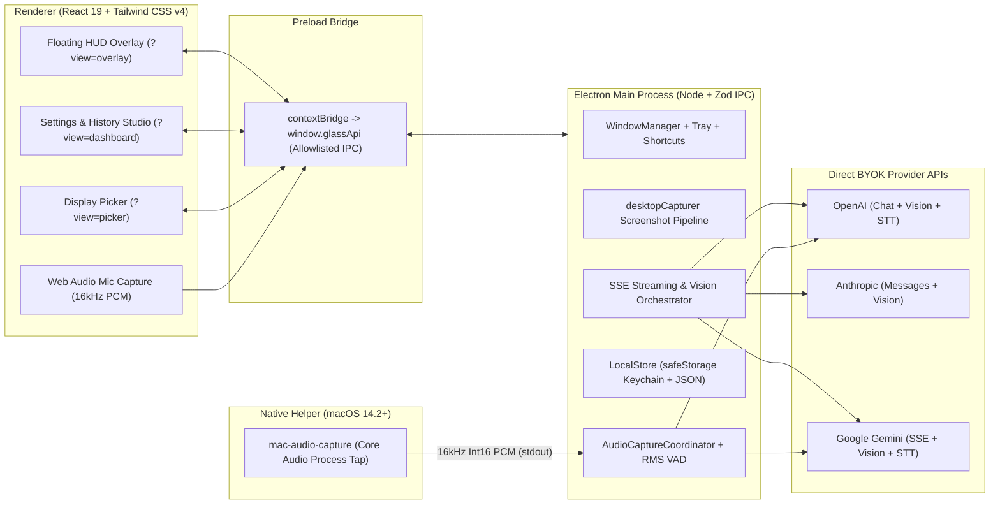

# GlassHUD Copilot

A clean-room, local-first Electron desktop AI overlay assistant with **BYOK streaming & vision** for **OpenAI**, **Anthropic**, and **Google Gemini**, live **macOS Core Audio + microphone transcription**, display-matched screenshot capture, and a full Settings & Session History studio.

> **100% Local & Private** — API keys are encrypted locally using your OS Keychain (`safeStorage`) and requests go directly from your machine to your chosen AI provider. No third-party backend, no telemetry, no account required.

---

## Highlights

- **Floating Translucent Glass HUD** — Always-on-top, frameless transparent overlay (`type: "panel"` on macOS) with dynamic mouse pass-through (`setIgnoreMouseEvents`) over transparent areas, drag/nudge positioning, resizable panel, multi-monitor picker, macOS menu bar tray, and toggleable screen-share privacy (`setContentProtection(true)`).
- **Multi-Provider BYOK Streaming & Vision** — Real-time SSE token streaming with cancellation and TTFT/total latency metrics for:
  - **OpenAI** (`gpt-4.1`, `gpt-4.1-mini`, `gpt-4o`, `o4-mini`, or custom model ID)
  - **Anthropic** (`claude-sonnet-4-20250514`, `claude-3-7-sonnet-latest`, `claude-3-5-haiku-latest`, or custom)
  - **Google Gemini** (`gemini-2.5-pro`, `gemini-2.5-flash`, `gemini-2.0-flash`, or custom)
  - Live **Test Key** verification against each provider's `/models` API right inside Settings.
- **Live System Audio + Microphone Transcription** — Native Swift Core Audio Process Tap CLI (`native/mac-audio-capture/main.swift`, macOS 14.2+) captures system audio at 16 kHz PCM alongside Web Audio microphone input. Built-in RMS Voice Activity Detection (VAD) frames speech into WAV utterances transcribed via **OpenAI** (`gpt-4o-mini-transcribe` / `whisper-1`) or **Google Gemini** (`gemini-2.5-flash`).
- **Screen Capture Vision** — Capture your active display via `desktopCapturer`, queue multiple snapshots, remove the last snapshot with a hotkey, and send them alongside live transcript context and follow-up text prompts.
- **Rich Markdown, Math & Code Output** — GFM tables, KaTeX math rendering, `highlight.js` syntax highlighting with line numbers, and one-click code copy buttons.
- **Settings & Session History Studio** — Encrypted key manager, built-in & custom system prompt CRUD, interactive shortcut recorder for all 19 global shortcuts, OS permission diagnostics, incognito toggle, and searchable local session history.

---

## Architecture



---

## Prerequisites

- **Node.js** 20+ (tested on Node 26)
- **macOS 14.2+** with Xcode Command Line Tools (`swiftc`) for native system audio capture (Windows & Linux work for screenshots, mic audio, and AI streaming)
- At least one API key from **OpenAI**, **Anthropic**, or **Google Gemini**

---

## Quick Start

```bash
# 1. Install dependencies
npm install

# 2. If npm blocks Electron's postinstall or you see "Error: Electron uninstall" (common on Node 26 / npm 11):
npm run fix:electron

# 3. Compile the native macOS Core Audio system-audio helper (macOS 14.2+)
npm run build:native

# 4. Run in development mode (Electron + Vite HMR)
npm run dev
```

Or build and run the production bundle directly:

```bash
npm run build:all
npm start
```

On first launch (when no API key is saved), the **Settings & Sessions** window opens automatically so you can configure your keys, run a live **Test**, and check macOS permissions.

---

## Default Global Shortcuts

All 19 shortcuts can be rebound interactively in **Settings -> Global Shortcuts**.

| Action | Default Shortcut |
| :--- | :--- |
| Show / Hide Overlay | `Cmd/Ctrl + B` |
| Ask AI (Send Context) | `Cmd/Ctrl + Enter` |
| Capture Screen | `Cmd/Ctrl + H` |
| Delete Last Screenshot | `Cmd/Ctrl + L` |
| Start New Session | `Cmd/Ctrl + G` |
| Toggle Audio Capture | `Cmd/Ctrl + Shift + \` |
| Decrease / Increase Opacity | `Cmd/Ctrl + [` / `Cmd/Ctrl + ]` |
| Zoom Out / In / Reset | `Cmd/Ctrl + -` / `Cmd/Ctrl + =` / `Cmd/Ctrl + 0` |
| Nudge HUD Position | `Cmd/Ctrl + Arrow Keys` |
| Scroll AI Response | `Cmd/Ctrl + Shift + Up / Down` |
| Switch to Response / Transcript Tab | `Alt + 1` / `Alt + 2` |

---

## Scripts & Packaging

| Command | Description |
| :--- | :--- |
| `npm run dev` | Start Electron + Vite dev server with HMR |
| `npm run build` | Build Electron main, preload, and renderer bundles (`out/`) |
| `npm run build:native` | Compile `native/mac-audio-capture/main.swift` to `resources/bin/mac-audio-capture` |
| `npm run build:all` | Build native macOS helper + all Electron bundles |
| `npm run fix:electron` | Cleanly extract Electron runtime via native `unzip` and write `path.txt` |
| `npm run package:mac` | Package macOS `.dmg` and `.zip` (arm64 + x64) into `dist/` |
| `npm run package:win` | Package Windows NSIS installer into `dist/` |
| `npm run package:linux` | Package Linux AppImage into `dist/` |
| `npm run typecheck` | Run `tsc --noEmit` for both Node and renderer tsconfigs |
| `npm test` | Run Vitest unit tests (SSE streaming, vision, STT, WAV/VAD, encrypted store, key verification) |

---

## macOS Permissions

- **Screen & System Audio Recording**: Required for screenshot capture (`desktopCapturer`) and Core Audio Process Tap system audio capture. Open **System Settings -> Privacy & Security -> Screen & System Audio Recording** (or click the shortcut link inside Settings -> Overlay & Audio).
- **Microphone**: Required only if you enable microphone capture alongside system audio.

---

## License

MIT License — see [LICENSE](LICENSE).
